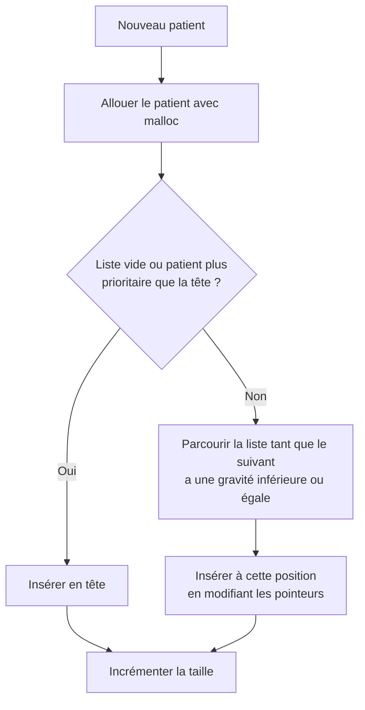

<div align="center">

# 🏥 UrgenceTriage

**Simulateur de tri et de gestion des urgences hospitalières en langage C**

File d'attente prioritaire · Liste chaînée · Statistiques · Sauvegarde sur fichiers


</div>

<!-- Remplace ce bloc par une capture d'écran ou un GIF de démonstration :
<p align="center"></p>
-->

---

## 📑 Sommaire

- [À propos](#-à-propos)
- [Fonctionnalités](#-fonctionnalités)
- [Règle de priorité](#-règle-de-priorité)
- [Installation et compilation](#-installation-et-compilation)
- [Utilisation](#-utilisation)
- [Architecture du projet](#-architecture-du-projet)
- [Conception technique](#-conception-technique)
- [Fichiers de données](#-fichiers-de-données)
- [Tests et qualité](#-tests-et-qualité)
- [Notions du langage C mises en pratique](#-notions-du-langage-c-mises-en-pratique)
- [Feuille de route](#-feuille-de-route)
- [Documentation](#-documentation)
- [Auteur](#-auteur)
- [Licence](#-licence)

---

## 📖 À propos

Dans un service d'urgences, les patients ne sont pas pris en charge dans l'ordre d'arrivée mais **selon la gravité de leur état**. Une personne victime d'un arrêt cardiaque passe avant un patient souffrant d'un simple mal de gorge.

**UrgenceTriage** simule ce fonctionnement : chaque patient reçoit un niveau de gravité de 1 à 5 à son arrivée, puis le programme maintient automatiquement une **file d'attente prioritaire**, indique qui appeler en premier, estime les temps d'attente et conserve l'historique de la journée.

Le projet est écrit en **C standard**, sans bibliothèque externe, et organisé en modules indépendants. Il a été conçu pour être simple à comprendre tout en appliquant les bonnes pratiques : gestion mémoire rigoureuse, saisies sécurisées, code documenté et compilation automatisée.

> ⚠️ **Avertissement** : projet pédagogique de simulation. Il ne remplace en aucun cas un logiciel médical réel et ne doit pas servir à prendre de vraies décisions de soins.

---

## ✨ Fonctionnalités

| Domaine | Fonctionnalités |
|---|---|
| **Patients** | Enregistrement (numéro automatique, nom, prénom, âge, symptôme, gravité), recherche par nom ou numéro, modification de la gravité avec repositionnement automatique, retrait d'un patient |
| **Prise en charge** | Appel du prochain patient, enregistrement de la fin de consultation, temps d'attente estimé pour chaque patient, alerte en cas de dépassement du délai cible |
| **Statistiques** | Patients accueillis et en attente, répartition par gravité (histogramme en mode texte), temps d'attente moyen / minimum / maximum, âge moyen, symptôme le plus fréquent |
| **Persistance** | Sauvegarde automatique à la fermeture, chargement automatique au démarrage, export d'un rapport de fin de journée |
| **Robustesse** | Toutes les saisies sont validées : le programme ne plante pas, même avec des entrées absurdes |

---

## 🚦 Règle de priorité

Le tri s'inspire des échelles de triage à 5 niveaux utilisées dans les services d'urgences.

| Niveau | Nom | Signification | Délai cible | Durée moyenne de consultation |
|:---:|---|---|:---:|:---:|
| 🔴 **1** | `CRITIQUE` | Vie en danger immédiat | Immédiat | 30 min |
| 🟠 **2** | `TRES_URGENT` | Risque vital possible | 10 min | 25 min |
| 🟡 **3** | `URGENT` | État sérieux mais stable | 30 min | 20 min |
| 🟢 **4** | `MOINS_URGENT` | Problème modéré | 60 min | 15 min |
| 🔵 **5** | `NON_URGENT` | Problème bénin | 120 min | 10 min |

**Deux règles décident de l'ordre de passage :**

1. Un patient de gravité **plus faible en numéro** (1 est le plus grave) passe toujours avant un patient de gravité plus élevée.
2. À **gravité égale**, le patient arrivé **le premier** passe en premier (premier arrivé, premier servi).

**Exemple.** La file contient `[2] Karim, [3] Sara, [3] Omar, [5] Lina`. Nour arrive avec une gravité 3 : elle est placée après Omar (même gravité, arrivée plus tard) et avant Lina.

```
Avant :  [2] Karim → [3] Sara → [3] Omar → [5] Lina
Après :  [2] Karim → [3] Sara → [3] Omar → [3] Nour → [5] Lina
```

---

## 🛠 Installation et compilation

### Prérequis

- Un compilateur C (`gcc` recommandé)
- `make`
- *(optionnel)* `valgrind` pour vérifier l'absence de fuites mémoire (Linux)

### Cloner et compiler

```bash
git clone https://github.com/<votre-utilisateur>/urgencetriage.git
cd urgencetriage
make
```

### Lancer

```bash
./urgencetriage        # Linux / macOS
urgencetriage.exe      # Windows
```

### Autres commandes `make`

| Commande | Action |
|---|---|
| `make` | Compile le projet |
| `make run` | Compile puis lance le programme |
| `make clean` | Supprime les fichiers objets et l'exécutable |
| `make valgrind` | Lance le programme sous Valgrind |

---

## 💻 Utilisation

Au lancement, un menu interactif s'affiche :

```
========== URGENCE TRIAGE ==========
Patients en attente : 4
Prochain patient : #12 Karim B. (gravité 2)
------------------------------------
1. Enregistrer un nouveau patient
2. Afficher la file d'attente
3. Appeler le prochain patient
4. Rechercher un patient
5. Modifier la gravité d'un patient
6. Statistiques de la journée
7. Exporter le rapport
0. Sauvegarder et quitter
Votre choix :
```

### Exemple d'affichage de la file

```
POS | N°  | NOM        | AGE | GRAVITE      | ATTENTE ESTIMEE
  1 | 12  | Karim B.   |  54 | TRES_URGENT  |   0 min
  2 |  9  | Sara M.    |  31 | URGENT       |  25 min
  3 | 11  | Omar T.    |   8 | URGENT       |  45 min
  4 | 10  | Lina K.    |  22 | NON_URGENT   |  65 min
```

### Scénario de démonstration

1. Enregistrer trois patients avec les gravités 5, 3 et 1.
2. Afficher la file : le patient de gravité 1 est en tête, malgré son arrivée tardive.
3. Appeler le prochain patient : le cas critique est pris en charge en premier.
4. Passer un patient de la gravité 4 à la gravité 1 : il remonte en tête de file.
5. Quitter, relancer le programme : la file est retrouvée à l'identique.

---

## 🗂 Architecture du projet

```
urgencetriage/
├── src/
│   ├── main.c          # Menu principal et boucle du programme
│   ├── patient.c/.h    # Structure Patient, enum Gravite, création d'un patient
│   ├── file.c/.h       # Liste chaînée : insertion triée, appel, suppression, recherche
│   ├── stats.c/.h      # Calcul des statistiques et de l'histogramme
│   ├── fichier.c/.h    # Sauvegarde et chargement
│   └── outils.c/.h     # Saisies sécurisées, effacement d'écran, dates
├── data/               # Fichiers de données et rapports générés
├── docs/               # Cahier des charges et schémas
├── Makefile            # Compilation automatique
├── LICENSE
└── README.md
```

Chaque module possède une responsabilité unique : l'interface (`main`), le modèle de données (`patient`), la file prioritaire (`file`), les calculs (`stats`), la persistance (`fichier`) et les utilitaires (`outils`).

---

## 🧠 Conception technique

### Structures de données

```c
typedef enum {
    CRITIQUE = 1,
    TRES_URGENT,
    URGENT,
    MOINS_URGENT,
    NON_URGENT
} Gravite;

typedef struct Patient {
    int numero;                 /* numéro automatique */
    char nom[30];
    char prenom[30];
    int age;
    char symptome[60];
    Gravite gravite;            /* énumération de 1 à 5 */
    time_t heureArrivee;        /* date et heure d'arrivée (time.h) */
    struct Patient *suivant;    /* pointeur vers le patient suivant */
} Patient;

typedef struct {
    Patient *tete;              /* prochain patient à appeler */
    int taille;                 /* nombre de patients en attente */
} FileAttente;
```

### File prioritaire : liste chaînée triée

La file est une **liste chaînée toujours triée** : à chaque arrivée, le patient est inséré directement à la bonne position. La tête de liste est donc en permanence le prochain patient à appeler, ce qui rend l'appel immédiat (on retire simplement la tête).



> Le choix de `inférieure ou égale` lors du parcours garantit le respect de l'ordre d'arrivée à gravité égale.

### Estimation du temps d'attente

Le temps d'attente estimé d'un patient est la **somme des durées moyennes de consultation** de tous les patients placés devant lui :

```c
int estimerAttente(FileAttente *file, Patient *cible) {
    int total = 0;
    Patient *p = file->tete;
    while (p != NULL && p != cible) {
        total += dureeMoyenne(p->gravite);   /* 30, 25, 20, 15 ou 10 min */
        p = p->suivant;
    }
    return total;
}
```

### Complexité

| Opération | Complexité |
|---|:---:|
| Insertion d'un patient (liste triée) | O(n) |
| Appel du prochain patient | O(1) |
| Recherche d'un patient | O(n) |
| Modification de la gravité (retrait + réinsertion) | O(n) |

Pour un service d'urgences (quelques dizaines à une centaine de patients), ces coûts sont négligeables.

---

## 💾 Fichiers de données

| Fichier | Format | Contenu |
|---|---|---|
| `data/file_attente.dat` | Binaire (`fwrite` / `fread`) | Patients encore en attente |
| `data/historique.csv` | Texte (`fprintf` / `fscanf`) | Patients pris en charge, avec leur temps d'attente |
| `data/rapport_jour.txt` | Texte | Rapport de fin de journée |

Un pointeur n'a aucun sens dans un fichier : à la sauvegarde, seules les **données** de chaque patient sont écrites. Au chargement, la liste est reconstruite avec `malloc` et l'insertion triée.

---

## ✅ Tests et qualité

### Scénarios de test

| N° | Scénario | Résultat attendu |
|:---:|---|---|
| T1 | Ajout de 3 patients de gravités 5, 3 et 1 | Ordre de la file : 1, 3, 5 |
| T2 | Ajout de deux patients de même gravité | Le premier arrivé passe en premier |
| T3 | Appel du prochain patient sur une file vide | Message clair, pas de plantage |
| T4 | Saisie d'une gravité égale à 9 ou d'un âge négatif | Saisie refusée et redemandée |
| T5 | Passage d'un patient de la gravité 4 à la gravité 1 | Il passe en tête de file |
| T6 | Fermeture puis réouverture du programme | La file est retrouvée identique |
| T7 | Suppression d'un patient en milieu de liste | Les liens de la liste restent corrects |
| T8 | Exécution complète sous Valgrind | Zéro fuite mémoire |

### Vérification de la mémoire

```bash
make valgrind
# équivalent à :
valgrind --leak-check=full --show-leak-kinds=all ./urgencetriage
```

Résultat attendu :

```
All heap blocks were freed -- no leaks are possible
ERROR SUMMARY: 0 errors from 0 contexts
```

### Standards de qualité

- Compilation sans avertissement avec `-Wall -Wextra -std=c11`
- Chaque `malloc` possède son `free`
- Vérification systématique du retour de `malloc` et de `fopen`
- Chaque fonction est documentée (rôle, paramètres, valeur de retour)
- Aucune saisie utilisateur n'est utilisée sans validation

---

## 📚 Notions du langage C mises en pratique

| Notion | Utilisation dans le projet |
|---|---|
| Types de base, opérateurs | Âge, numéros, durées, moyennes |
| Entrées / sorties (`printf`, `fgets`) | Menu et saisie sécurisée des patients |
| Conditions et boucles | Menu, parcours de la file, alertes |
| Fonctions et prototypes | Découpage de toutes les fonctionnalités |
| Tableaux | Compteurs par niveau de gravité |
| Chaînes de caractères (`string.h`) | Noms, symptômes, recherche |
| `struct`, `enum`, `typedef` | Patient, FileAttente, niveaux de gravité |
| **Pointeurs** | Passage par adresse, parcours et modification de la liste |
| **Allocation dynamique** (`malloc`, `free`) | Création et libération des patients |
| **Listes chaînées** | File d'attente prioritaire |
| Fichiers (`fopen`, `fread`, `fwrite`, `fprintf`, `fscanf`) | Sauvegarde, historique, rapport |
| Macros et `#define` | Constantes (tailles, durées par niveau) |
| `time.h` | Heure d'arrivée et temps d'attente réel |
| Compilation modulaire (`.h` / `.c`, Makefile) | Organisation du projet |
| Gestion d'erreurs | Vérification de `fopen`, `malloc` et des saisies |

---

## 🗺 Feuille de route

**Version actuelle**

- [x] Enregistrement des patients avec validation des saisies
- [x] File prioritaire en liste chaînée triée
- [x] Appel du prochain patient
- [x] Estimation des temps d'attente et alertes de dépassement
- [x] Recherche, modification de gravité, suppression
- [x] Statistiques de la journée avec histogramme
- [x] Sauvegarde, chargement et export du rapport

**Évolutions envisagées**

- [ ] Plusieurs médecins disponibles, avec une salle de consultation par médecin
- [ ] Simulation d'une journée complète avec arrivées aléatoires
- [ ] Mode « afflux massif » pour tester la robustesse
- [ ] Priorité automatique pour les enfants de moins de 3 ans et les personnes de plus de 80 ans à gravité égale
- [ ] Tests unitaires avec `assert.h`

---

## 📄 Documentation

Un résumé des notions essentielles de programmation en C, illustré par des exemples, est disponible dans [`docs/Resume_langage_C.pdf`](docs/Resume_langage_C.pdf).

---

## 👩‍💻 Auteur

**Alazhar Yasmine**

Projet réalisé dans le cadre du module Programmation C, sous l'encadrement de **Hamza Yossra**. Année universitaire 2026/2027.

---

## 📜 Licence

Ce projet est distribué sous licence **MIT**. Voir le fichier [`LICENSE`](LICENSE) pour plus de détails.

